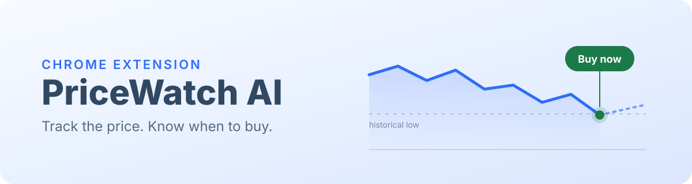
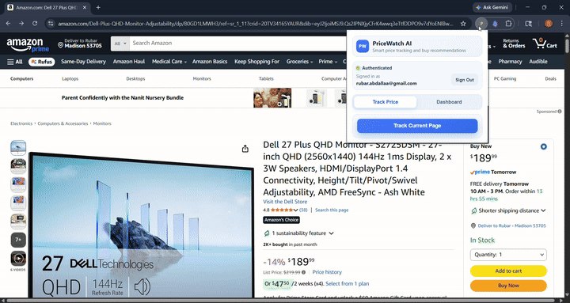
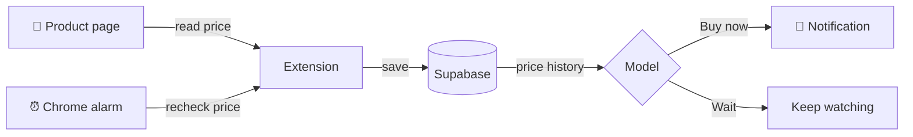
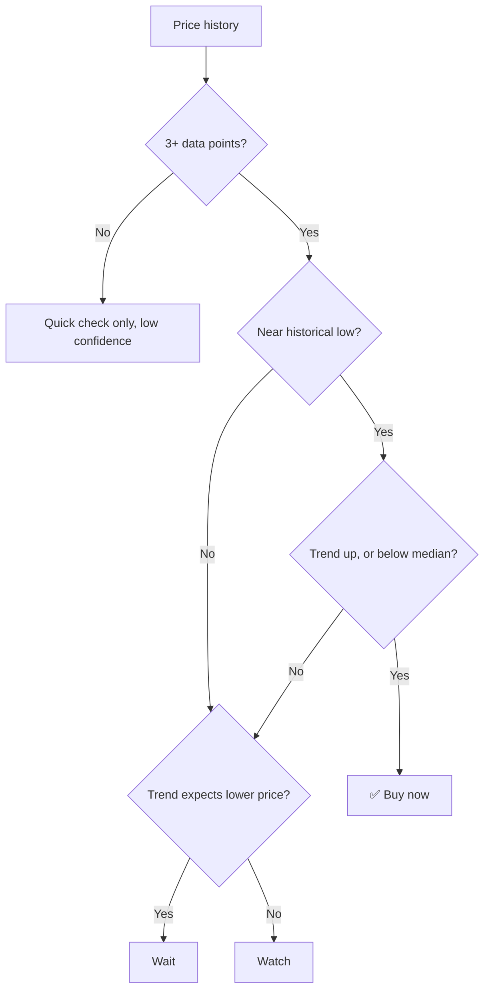

  

  A Chrome extension that watches prices for you, so you stop checking the same page every day.

  
  
  

## Demo

  

---

## The problem

> When I find a product I want but I'm unsure about the price, help me know whether to buy now or wait, without checking the price again and again.

Most price trackers send an alert when the price drops. That still leaves the real question open: *will it drop more?* PriceWatch tries to answer that question.

## How it works

1. **Capture.** On any product page, the extension reads the current price from the page.
2. **Track.** Chrome alarms revisit tracked items in the background and save each price to Supabase.
3. **Decide.** A small model looks at the price history and returns **Buy now** or **Wait**, with a confidence score.
4. **Notify.** You get a Chrome notification when it's a good time to buy.

### The buy / wait logic

## Design decisions

- **Simple model on purpose.** The recommendation is a linear trend over the last 30 price points, plus three checks: Is the price near its historical low? Is the trend going up? Is the price below the median? I picked this over an LLM because it's fast, free, runs on the user's machine, and every decision can be explained.
- **Honest confidence.** Confidence grows with the amount of data and how well the trend fits (R²). With fewer than 3 data points, the extension says so and doesn't guess.
- **Security first.** The extension uses only Supabase's public key. Row-level security makes sure each user can see only their own items. No service-role key lives on the client.

## Known limitations

- The trend line treats price checks as evenly spaced, but the real checks are not.
- Background checks run only while Chrome is open. A server-side job would be more reliable.
- Price reading depends on each store's page layout, so some sites may fail.

## Tech

Chrome Extension (Manifest V3) · JavaScript · Supabase (Auth, Postgres, RLS) · Chart.js

## Run it locally

1. Copy `config.example.js` to `config.js`, then add your Supabase URL and anon key.
2. Run the SQL files in `supabase/` in your Supabase project.
3. Open `chrome://extensions`, turn on **Developer mode**, click **Load unpacked**, and select this folder.

## Why it needs these permissions

`activeTab` + `scripting` read the price on the current page · `tabs` opens background check tabs · `alarms` schedules checks · `notifications` sends buy alerts · `storage` keeps your sign-in session. Broad host access lets it revisit products on any store.

---

Built for ISyE 602 (UW–Madison, Spring 2026) by a 7-person team. I designed and wrote the full codebase: UI, background checks, recommendation logic, and auth.
